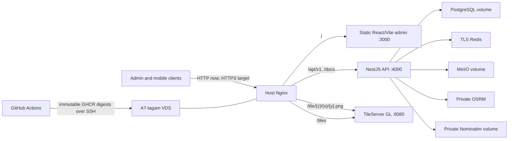

# A7-tagam infrastructure inventory

This document is the operational source of truth for the currently deployed
infrastructure. It records names, responsibilities and recovery procedures,
never secret values. Update it in the same commit whenever a host, public URL,
port, service, volume, GitHub setting, registry or deployment branch changes.

Last audited: 2026-08-18.

## Current answer: production only

The only active deployment is production. `main` builds hardened immutable
containers and deploys them through the GitHub `production` Environment to the
single VDS. The runtime declares both `NODE_ENV=production` and
`DEPLOYMENT_ENVIRONMENT=production` and uses PostgreSQL, TLS Redis, MinIO,
TileServer GL, OSRM and Nominatim on the private Compose network.

Production currently has an explicitly temporary transport limitation: traffic
uses plain HTTP on the server IP until Turkmen Telecom supplies DNS and the
ordered certificate for `a7-tagam.com.tm`. During customer testing, two
env-only allowlisted accounts have a time-boxed reusable OTP exception through
2026-09-18; its phone numbers and code exist only in the protected server env.
All other accounts use the Android pull SMS gateway, and the allowlisted
accounts return to it automatically after expiry. Off-host backups and external
monitoring/alerting still need to be completed.

The repository contains the operations admin, not a customer web storefront.
Android/iOS applications remain separate projects and consume this API/map
contract; they are not built or released by this monorepo. ChatGPT Sites and
Cloudflare Workers are not deployment targets.

## Topology



TileServer provides only the visual base map. Courier GPS, orders, customer
data and route authorization always pass through NestJS. OSRM and Nominatim are
never public client endpoints.

## Host and capacity

| Item | Current value |
| --- | --- |
| Host name | `a7-tagam` |
| Public IP | `216.250.12.132` |
| OS | Ubuntu 26.04 |
| Capacity | 4 vCPU, 3910 MB RAM, 60 GB-class disk |
| Swap | 2047 MB |
| Deployment directory | `/opt/alowalow/production` |
| Compose project | `alowalow-production` |
| Runtime env | `.env.production`, owner `ubuntu`, mode `600` |
| Release manifest | `.release.env`, immutable image digests, no secrets |
| Pre-switch archive | `/opt/alowalow/archive-pre-production-20260815` |

After the production cutover, roughly 29 GB of the root disk was free and
2.7 GB RAM was available. Retained immutable images and the offline migration
snapshot intentionally consume additional temporary space. Cleanup must never
remove named volumes or runtime map/routing directories.

The pre-switch directory and the three legacy `alowalow-development_*` volumes
are offline rollback snapshots, not an active DEV environment. They must not be
started or treated as DEV. Keep them only until the production backup/restore
procedure and customer acceptance are complete, then remove them through a
separately approved cleanup.

## Host software

| Component | Audited version/status |
| --- | --- |
| Docker Engine | `29.1.3`, enabled |
| Docker Compose plugin | `2.40.3` |
| Nginx | `1.28.3` Ubuntu, enabled |
| OpenSSH | `10.2p1` Ubuntu; `ssh.socket` enabled |
| OpenSSL | `3.5.5` |
| Certbot | isolated `5.7.0` virtual environment under `/opt/alowalow/tools/` |

Certbot has no active renewal timer; the intended certificate is owned and
installed by Turkmen Telecom. The VDS has no VPN and does not build the Node.js
applications. GitHub Actions builds the images and the VDS only pulls immutable
digests. No permanent GHCR credential is stored on the host.

## Public and internal URLs

Temporary domestic testing:

```text
Admin:          http://216.250.12.132/
API:            http://216.250.12.132/api/v1
Swagger:        http://216.250.12.132/docs
OpenAPI JSON:   http://216.250.12.132/docs-json
Raster XYZ:     http://216.250.12.132/tile/{z}/{x}/{y}.png
MapLibre style: http://216.250.12.132/tiles/styles/alowalow/style.json
```

Final same-origin target after Telecom installs DNS and SSL:

```text
https://a7-tagam.com.tm/
https://a7-tagam.com.tm/api/v1
https://a7-tagam.com.tm/docs
https://a7-tagam.com.tm/docs-json
https://a7-tagam.com.tm/tile/{z}/{x}/{y}.png
https://a7-tagam.com.tm/tiles/styles/alowalow/style.json
```

The admin and mobile base-map contract is the simple PNG XYZ `/tile/` URL. The
application build uses relative `/api/v1` and `/tile` paths, so the same image
moves from HTTP/IP to HTTPS/domain without rebuilding business code. The source
map extract covers Turkmenistan; JSON/vector endpoints remain available for
advanced clients but are not required by the current admin/mobile integration.

## Ports and ingress

| Port/binding | Owner | Exposure |
| --- | --- | --- |
| `0.0.0.0:80` | host Nginx | temporary HTTP origin |
| `0.0.0.0:22` | host sshd | administration |
| `0.0.0.0:443` | host sshd | temporary GitHub deploy transport |
| `127.0.0.1:3000` | admin container | host Nginx only |
| `127.0.0.1:4000` | API container | host Nginx only |
| `127.0.0.1:8080` | TileServer GL | host Nginx only |
| Docker network only | PostgreSQL, Redis, MinIO, OSRM, Nominatim | not public |

The active Nginx site is currently
`a7-tagam-http-temporary.conf`. Before HTTPS activation, port `443` must move
from sshd to Nginx and GitHub deploy must receive another reachable transport.

## Runtime services and persistence

| Service | Purpose | Persistence |
| --- | --- | --- |
| `api` | NestJS business API | stateless container |
| `admin` | static React/Vite files on unprivileged Nginx | stateless container |
| `migrate` | `prisma migrate deploy` before API replacement | one-shot |
| `postgres` | users, orders, catalog, audit/history | named volume |
| `redis` | OTP, rate limits, GPS latest point, SMS queue | intentionally ephemeral |
| `minio` | private product/banner images | named volume |
| `minio-init` | idempotent bucket creation | one-shot |
| `tileserver` | web/mobile OSM style, PBF and PNG tiles | host map runtime, read-only |
| `routing` | private OSRM road routing | host routing runtime, read-only |
| `geocoding` | private Nominatim search/reverse index | named volume |

The three active production data volumes are declared `external` in Compose.
This protects them from normal project replacement and `compose down
--volumes`; `prepare-production-host.sh` creates them explicitly on a new host.

All runtime images are pinned by digest. Repository-owned API, migration and
admin images come from GHCR. Third-party images that the VDS cannot fetch from
public Docker Hub are pulled through `nexus.telecom.tm` with their upstream
digest preserved.

Persistent data is not the same as a backup. Before final production, configure
and test encrypted off-host backups for PostgreSQL and MinIO, define retention,
and perform an actual restore drill. Nominatim can be rebuilt from the checked
Turkmenistan PBF but its volume should still be protected from accidental
deletion during ordinary releases.

## GitHub Actions settings

Workflow: `.github/workflows/ci-cd.yml`.

Active branch flow:

```text
feature branch -> pull request -> main -> quality gates -> GHCR -> production VDS
```

Repository variables:

| Name | Current value | Purpose |
| --- | --- | --- |
| `PRODUCTION_DEPLOY_ENABLED` | `true` | permit automatic production deployment |

GitHub Environment `production` variables:

| Name | Current value |
| --- | --- |
| `API_PORT` | `4000` |
| `ADMIN_PORT` | `3000` |
| `DEPLOY_SSH_PORT` | `443` |

GitHub Environment `production` encrypted secrets:

| Name | What it contains |
| --- | --- |
| `DEPLOY_SSH_HOST` | deployment host address |
| `DEPLOY_SSH_USER` | non-root deployment user |
| `DEPLOY_SSH_PRIVATE_KEY` | dedicated ED25519 private key |
| `DEPLOY_SSH_KNOWN_HOSTS` | verified host keys for ports 22 and 443 |
| `LONG_LIVED_TEST_OTP_PHONES` | temporary encrypted production test allowlist |
| `LONG_LIVED_TEST_OTP_CODE` | temporary encrypted reusable test code |
| `LONG_LIVED_TEST_OTP_EXPIRES_AT` | approved ISO expiry for the temporary exception |

The three `LONG_LIVED_TEST_OTP_*` secrets exist only for the approved testing
window. The deploy job validates the complete set, transfers it in a mode-600
temporary file, atomically updates the protected VDS env and deletes the
temporary file. Delete the three Environment secrets and clear the VDS fields
when testing ends. `GITHUB_TOKEN` is generated automatically for each job, is
used for a short-lived GHCR login over SSH stdin, and is followed by
`docker logout`; no permanent GHCR token is stored on the VDS.

The manually dispatched `Production operations` workflow is read-only: it can
inspect bounded API container status/logs through the same verified deploy key.
It cannot change env values, restart containers or deploy a release.

Only the GitHub `production` Environment participates in deployment and it
accepts only `main`. There is no active DEV Environment or DEV deploy job.

## Where application secrets live

Real runtime values live in `/opt/alowalow/production/.env.production` with
mode `600`. The only application values also held by GitHub are the three
temporary encrypted test-OTP Environment secrets described above; they are
available only to the protected production deploy job. Frontend builds never
receive backend secrets.

The VDS env contains these secret categories:

- database: `POSTGRES_*`, `DATABASE_URL`;
- auth/OTP: `JWT_ACCESS_SECRET`, `OTP_PEPPER`, token TTL settings;
- TLS Redis: `REDIS_PASSWORD`, `REDIS_URL` plus files under `redis-tls/`;
- Android SMS gateway: `SMS_PROVIDER`, `SMS_GATEWAY_DEVICE_ID`,
  `SMS_GATEWAY_DEVICE_TOKEN`, `SMS_GATEWAY_ENCRYPTION_KEY`;
- S3/MinIO: `MINIO_*`, `S3_*`;
- Firebase push: `FCM_SERVICE_ACCOUNT_BASE64`, `PUSH_PROVIDER`;
- routing/geocoding provider origins and private Nominatim password;
- an optional time-boxed test OTP allowlist, code, expiry and explicit
  production acknowledgement; values exist only during approved testing.

Never print, copy into documentation, commit, or send any value from this
file. Rotation is done one secret at a time with a controlled API restart. JWT,
OTP pepper, encryption-key or database-password rotation may invalidate active
sessions/jobs and therefore requires a maintenance plan.

## Release and rollback

Every push to `main` must pass:

1. API lint, build, tests, coverage and full/production audits.
2. Admin lint, production Vite build, smoke/contract tests and audits.
3. Swagger contract regeneration with a clean Git diff.
4. Hardened API, migration and static Nginx image builds.
5. Production single-host Compose validation.

BuildKit publishes immutable digest references with provenance and SBOM. The
deploy job copies only Compose/release files, performs GHCR login with the
job-scoped token, pulls images, runs migrations, starts the stack and waits for
health checks. `.release.env` becomes active only after pulls succeed. If the
new stack is unhealthy, `deploy-production.sh` restores the previous release
manifest and starts the previous digests.

Telecom routing to SSH port 443 can intermittently return `connection refused`
for a GitHub-hosted runner. A retry of only the failed deploy job is safe when
all quality/image jobs are already green; it may receive a runner with a
working route. Do not disable security controls, store a permanent registry
token or expose Docker to work around this network issue.

## Operational checks

Public checks during temporary HTTP testing:

```bash
curl --fail http://216.250.12.132/api/v1/health
curl --fail http://216.250.12.132/
curl --fail http://216.250.12.132/docs-json
curl --fail \
  --output /tmp/a7-tagam-map-tile.png \
  http://216.250.12.132/tile/10/677/395.png
```

Server checks:

```bash
cd /opt/alowalow/production
docker compose \
  --env-file .release.env \
  --file docker-compose.production.yml \
  --file docker-compose.single-host.yml \
  ps
docker stats --no-stream
df -h /
free -h
sudo nginx -t
```

Do not run `docker compose down --volumes`, `docker system prune --volumes`, or
delete `maps-runtime`, `routing-runtime`, `.env.production`, `redis-tls`, or
named volumes during routine deployment.

## Remaining production hardening

- DNS `a7-tagam.com.tm` resolves to the VDS inside the intended network.
- Turkmen Telecom certificate is installed and its renewal owner is documented.
- Nginx owns 443; HTTP redirects to HTTPS; mobile cleartext exceptions are
  removed.
- GitHub deploy uses a reachable transport other than the HTTPS listener.
- `DEPLOYMENT_ENVIRONMENT=production` remains enforced and the temporary test
  OTP exception is removed no later than 2026-09-18.
- PostgreSQL and MinIO encrypted off-host backups and restore tests exist.
- Monitoring, alerting, log retention and disk-capacity alarms exist.
- Android/iOS production builds use the HTTPS API and MapLibre style URLs.
- Security review, customer acceptance and rollback drill are complete.

## Future DEV environment (not active)

DEV must be added later as a separate deployment, never by changing the active
production runtime back to development. It needs its own GitHub Environment and
enable variable, deployment directory, Compose project, loopback ports,
PostgreSQL/MinIO/Nominatim data, Redis secrets, S3 bucket, Android gateway
identity and monitoring. A future branch policy can be chosen at that time;
until then only `main → production` exists. Production secrets and named
volumes must never be copied into DEV.

Detailed provisioning and TLS commands remain in `docs/DEPLOYMENT.md`; mobile
map integration remains in `docs/MOBILE_MAP_AND_ROUTING.md`.
